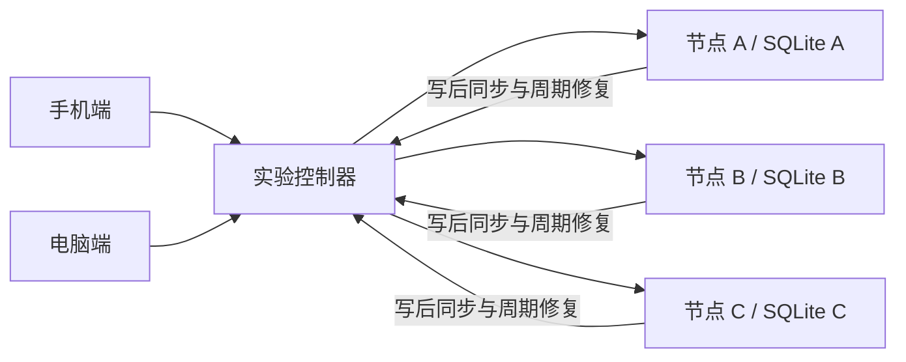

# 实现与系统保证

## 1. 拓扑与进程

默认启动一个控制器、A/B/C 三个独立 Python 进程。节点各有一个 SQLite 数据库。两个网页客户端默认分别连接 A 和 B，操作同一个 `cart_id`。D 用于新增副本导入实验。



节点间同步消息经控制器转发，以统一注入双向分区、重复、延迟和乱序。业务操作也经控制器代理，但故障门控仅作用于副本同步。直接访问节点端口同样可以调用节点 API。

实验模拟的“断网”是消息层双向丢弃，节点“宕机”是停止实际进程，“回拨”是节点内部可注入时钟，不修改操作系统。响应丢失用一次 504/结果未知来模拟，节点实际已经提交。

## 2. 数据模型与数量语义

每个购物车存储以下完整 CRDT 状态：

```json
{
  "adds": {"请求ID:操作指纹前缀": "apple"},
  "removed": [],
  "vv": {"A@独立身份": 1},
  "requests": {"请求ID": ["操作指纹"]}
}
```

- `adds`：每个标记代表一件商品，标记关联的 SKU 不可变。
- `removed`：已观察删除的标记；仅增长。
- `vv`：节点身份到逻辑计数的映射。
- `requests`：请求 ID 对应的操作指纹集合；用于去重和检测错误复用。

可见商品实例为 `adds.keys() - removed`。对同一 SKU 的可见实例计数得到数量。金额仅为演示目录中的整数分金额计算，不涉及库存或支付。

### 添加

每个独立点击生成新请求 ID。标记由请求 ID 和操作指纹确定，因此同一请求即使被另一个分区接受，也不会生成第二件商品。同一商品的两个独立请求则各保留一件。

### 减一与整项移除

客户端在读取中获得当前标记。减一提交其中一个标记，整项移除提交已见的所有该 SKU 标记。服务端仅删除提交的已观察标记，不读取新状态后偷偷扩大删除范围。

客户端发出的删除若包含目标节点未知的标记，会被拒绝，需先读取/同步目标节点。当前网页的读和写指向同一选定节点。

两个客户端同时删除同一商品实例，结果只删除一件。两个客户端删除不同实例，结果删除两件。这项业务语义必须在答辩中说明。

### 并发添加优先

旧苹果标记 `t1` 已被 A/B 看到。A 删除 `t1`，B 并发新增 `t2`。合并得到添加 `{t1,t2}`、删除 `{t1}`，可见 `{t2}`。读到 `t2` 后再删除它，可见集合为空。

## 3. 合并与收敛

`merge` 对添加事实取并集，对删除标记取并集，对请求指纹集合取并集，对版本向量各分量取最大值。

这些操作分别满足交换律、结合律、幂等律。在状态合法、添加标记唯一且不被修改、删除记录不丢弃的前提下，任意顺序、任意重复次数的完整状态合并都会得到相同结果。测试用固定随机种子产生更新与同步序列，再打乱并三重投递历史状态验证。

本实现不单独根据版本向量丢弃输入状态；所有合法事实都参与合并。这样版本信息的展示不会替代业务内容合并。元数据严格保留，未实现压缩或垃圾回收。

本地事务提交、合并到新状态后，立即唤醒同步线程发送相应购物车状态；恢复网络、重启节点、迁移完成会主动请求完整同步。所有复制仍经过同一消息转发器，服从分区、延迟、重复与乱序设置。

周期同步默认约每 10 秒发送完整快照，作为丢失修复。SSE 的 change 事件用于数据和节点变化，messages 事件用于有教学意义的消息进度；普通后台无变化投递不触发这两个事件。页面在消息事件后调用轻量的 /api/messages，不再为每条消息读取所有节点。通知中断时每 5 秒读取状态作备用；正常连接时另保留 30 秒的状态检查，以发现控制器之外发生的进程故障。消息统计每 10 秒轻量更新，在途倒计时每秒更新对应文本。

写入响应只更新返回该响应的节点视图，其他节点必须通过实际读取更新。MessageJournal 为当前实验保留最近 100 次用户操作，每次最多 48 条关键消息；原始日志环形保留 160 条。它记录客户端尝试、同步消息组、阻断/拒收/送达和历史接收节点，不参与 CRDT 正确性决策。匹配依据是请求 ID 与规范化操作指纹，避免仅凭整份快照里出现旧 ID 就误认为新用户操作。旧关键记录不会被普通后台消息覆盖；控制器重启后这些内存观测消失，节点持久化数据不受影响。

没有永久分区、没有持续丢失且所有相关更新充分传播时，副本最终收敛。正常网络下用户感知应接近实时，但不存在两块屏幕同一瞬间变化的保证。

## 4. 版本向量与身份

每个数据库首次创建一个随机节点身份，例如 `A@4c12...`，并持久化计数。节点每次新操作在事务中递增自己的计数；重试不递增。每个购物车的向量只记录与其有关的各节点最大计数。

本实现每个数据库共用一个单调计数，因此某一购物车的分量可能跳号；分量表示该节点对该购物车已包含的最新操作编号，不应解释为这个购物车恰好接受了多少次操作。

比较规则：所有分量小于等于且至少一个更小为因果先于；各有一个更大的分量为并发；全部相等为相同版本信息。客户端在同一节点读后写自然包含已读上下文；跨节点请求的因果保证取决于是否已同步，未实现自动携带完整客户端因果上下文的会话协议。

不使用物理时间决定更新胜负。恢复同一个持久化数据库时保持身份和计数；使用全新数据库时产生新身份，避免把历史节点计数从零重用。本项目没有实现“恢复到旧备份但继续复用同一身份”的安全恢复协议。

## 5. 原子提交与请求去重

SQLite 启用 WAL 和 `synchronous=FULL`，节点内通过锁序列化写事务。一次成功操作在同一事务中保存购物车、版本计数和请求指纹。事务提交完成后才返回确认。

请求指纹覆盖操作类型、SKU、排序后的观察标记。同 ID 同内容返回重复处理结果；同 ID 不同内容在当前节点已知的情况下拒绝。

同 ID 错误地用于分区两侧的不同内容，无法无协调地全局即时拒绝。系统保留指纹并集并显示冲突；这一情况是客户端违反请求 ID 约定，不属于正常重试。

成功只确认 **W=1 个本地持久化副本**。从单个选定节点读取，不要求读 quorum。这里没有通过 `R+W>N` 构造强一致读。

若要求写入必须取得两个指定副本确认，孤立节点无法给出这种成功确认。响应超时也不必然代表未执行。`R+W>N` 在固定副本集合下可保证读写集合相交，但仅靠这个条件不能证明线性一致性；并发写、版本选择、故障与成员变更仍需协议处理。

## 6. 故障控制

| 故障 | 实现 |
|---|---|
| 分区 | 消息入队和投递前均检查有向边；隔离 A 同时屏蔽 A↔B、A↔C、A↔D |
| 重复 | 同一状态排队三份，不将其转换为三次用户操作 |
| 延迟 | 以单调时钟计算最早投递时间 |
| 乱序 | 按同一源节点的显式写入轮次，交替增加 2 秒延迟；后台轮次不影响选择。引导实验等待旧快照实际排队，再发删除操作，并验证两条指定消息的实际送达时间 |
| 宕机 | 控制器终止自己创建的指定节点进程，不删除数据库 |
| 响应丢失 | 代理收到节点成功结果后丢弃这次结果，客户端收到不确定响应 |
| 时间回拨 | 节点日志与展示时钟偏移 -60 秒，逻辑计数不受影响 |

消息队列有容量上限，超过上限会丢弃并计数；下一轮完整状态用于修复。同一来源到同一目标若已有周期补同步消息排队，跳过新一轮周期包，避免长延迟和重复投递使旧后台快照不断积压；用户写入、重试与主动恢复不受此限制。投递循环只在没有到期消息时短暂等待，避免在重复消息下人为限制排空速度。

## 7. 新节点导入

1. D 以 `ready=false` 启动，拒绝普通业务写入与常规副本合并。
2. 从 A 读取完整快照；分片并保存完整快照 SHA-256。
3. 分片进入独立暂存表，重发同一片可覆盖相同片号。
4. 收齐后校验片数、校验和与状态格式。
5. 在同一事务中导入状态、置 `ready=true`、删除本次暂存记录。
6. 立即触发完整同步，补齐快照生成之后的新更新，周期同步继续修复遗漏。

演示模式支持在第 4/8 片暂停，等待用户制造进程故障或继续。新一轮迁移使用新数据库并保留旧文件，因此已成功迁移的 D 不会阻碍下一次演示。切换场景会取消仍在运行或暂停的导入。

中途停止 D 后，暂存片段保留，但不会暴露为完整购物车。重试从 A 获取新快照并重新导入，不实现断点续传。导入原子提交只保证本地快照完整性，不保证刚开放服务就包含其他节点所有最新更新。

## 8. CAS 与热点实验

CAS 使用单节点独立表与事务锁。两个请求期望相同版本时，仅一个更新成功。该表不参与复制；两个节点各自 CAS 成功的实验用于说明局部原子性不等于全局原子性。

热点压测将一半客户端请求集中到同一购物车。所有请求都写 A，便于固定路由并核对数量；测量混合负载的吞吐、P50/P95、错误率。它不证明热点分片已解决，也不隔离出 key 集中相对于均匀负载的因果影响。

## 9. 面板与证据

节点状态由真实 HTTP 读取。离线节点显示不可读取，不用缓存伪装当前状态。收敛标记比较可服务节点的完整 CRDT 状态哈希，并同时列出比较范围。

状态查询并发读取不同节点，属于多个时刻的观测，不是原子快照。答辩应结合持续稳定的状态、操作记录和自动测试说明保证，不凭一次绿色标记声称证明了任意执行下的正确性。

## 10. 代码阅读顺序

`crdt.py` → `storage.py` → `node.py` → `lab.py` → `tests/test_integration.py` → `web/app.js`。

先理解哪些事实只能增长，再看持久化边界，最后看故障如何影响消息与客户端结果。
