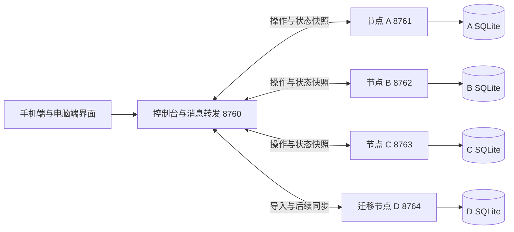

# 网络分区购物车技术报告

项目仓库(https://github.com/Apocania/parallel_exp/)

## 1. 业务目标与一致性约定

针对同一用户的购物车，节点间断联时仍允许各端本地操作，恢复后通过基于状态的 CRDT 合并，最终得到一致结果。

每个节点进程使用独立 SQLite 保存副本。演示时手机连接 A、电脑连接 B，C 作为额外副本观察传播结果；三者都能正常读写。D 默认用于迁移实验，完成导入后也是普通副本。写入成功表示当前节点已经持久化，其他节点异步同步。

## 2. 项目架构与节点启动

### 2.1 进程和文件职责

| 代码 | 作用 |
|---|---|
| `run.py` | 调用控制服务入口 |
| `cartlab/lab.py` | 管理节点进程、端口、网络故障、消息转发、迁移和控制台 API |
| `cartlab/node.py` | 节点 HTTP 路由、本地操作、同步触发和内部导入接口 |
| `cartlab/http_util.py` | 处理节点间 HTTP 通信、请求解析和基础校验 |
| `cartlab/storage.py` | SQLite 表、读写事务、快照、CAS 和迁移暂存 |
| `cartlab/crdt.py` | 操作校验、商品标记、删除集合、版本向量、请求去重和合并 |
| `cartlab/observations.py` | 记录请求及消息传播过程，提供观测证据 |
| `web/app.js`、`web/scenarios.js` | 提供分步实验、双端操作和状态观察 |
| `web/free.js` | 提供自由加购、逐条消息控制、迁移、CAS 和热点压测 |
| `tests/`、`tools/benchmark.py` | 自动化验证和 50% 热点压测 |




### 2.2 启动、端口和进程隔离

在项目根目录执行以下命令。

```powershell
python run.py
```

打开 <http://127.0.0.1:8760/> 使用分步实验，或进入 <http://127.0.0.1:8760/free> 使用自由实验台。默认启动 A/B/C，D 按需启动，客户端可切换连接的节点。

控制器为每个节点启动独立 Python 子进程，传入名称、端口、数据库路径和控制器地址，再检查服务是否可用。节点默认使用 8761～8764，可通过 `--port`、`--node-base-port` 修改控制台端口和节点起始端口。

## 3. 一次用户操作的完整路径

### 3.1 从加入牛奶到副本交付

以手机端经 A 加入一件牛奶为例。

1. 手机端点击牛奶加号，页面生成唯一请求 ID，经控制器转交 A。
2. A 校验商品和操作，读取购物车并检查请求是否已处理过。
3. A 把购物车、请求记录和逻辑计数在一个事务中提交，再返回成功。此时‘加入牛奶1’ 落盘保存，并向其他节点广播信息。
4. 后台复制线程把购物车完整状态交给控制器，后者为其他副本排队，按链路和延迟设置交付。接收节点合并并保存，有变化才继续传播。
5. 页面重新读取各节点，分别展示手机和电脑实际可见的商品，允许短暂不同。

### 3.2 数量、删除和请求重试

| 页面操作 | 业务含义 | 合并时的效果 |
|---|---|---|
| 商品卡片或加号 | 独立加入一件商品 | 保留这次新增，按商品种类合为一行 |
| 减号 | 删除当前看到的一件 | 两端删除同一件（只删除这一件） |
| 移除 | 删除当前看到的该商品全部件 | 另一端尚未被观察到的并发新增仍保留 |
| 重发原请求 | 确认同一次操作是否已执行 | 不把重试当成新的加购 |

CRDT逻辑：SKU 用于区分商品种类，唯一标记区分具体商品。执行删除时，引用已观察到的标记，在接收副本合并这些记录。


## 4. 持久化、快照与副本合并

### 4.1 本地提交与持久化

```python
with self.lock, self.db:
    state = self._get(cart_id)
    counter = max(int(self.meta("counter")), state["vv"].get(self.actor, 0)) + 1
    updated, duplicate = crdt.apply(state, operation, request_id, self.actor, counter)
    if not duplicate:
        self._put(cart_id, updated)
        self.db.execute("UPDATE meta SET value=? WHERE key='counter'", (str(counter),))
```

节点读取旧购物车，检查新请求并计算新状态，确认这是未处理的新请求，执行操作并递增逻辑计数；锁保护整个读改写过程，避免并发请求根据同一旧值互相覆盖；购物车和计数在同一事务保存，正常事务运行结束后提交、发生异常后执行回滚，提交后返回成功。

A/B/C 常规运行使用三个独立本地数据库，D 加入后有四个活跃副本数据库。每个库内的六张表分工如下。

| 表 | 保存的数据及用途 |
|---|---|
| `carts` | 正式购物车状态，包含商品记录、删除记录和已处理请求 |
| `meta` | 本节点身份、逻辑计数和是否可服务 |
| `events` | 节点写入、同步及恢复等事件 |
| `cas` | 当前节点的条件更新数据 |
| `migration`、`chunks` | 导入任务和尚未提交的快照分片 |

重启后仍可从磁盘识别请求更新状态，维护数据一致性。

### 4.2 快照的生成、传输和保存

```python
snapshot = store.snapshot() if send_all else {cart_id: store.read(cart_id) for cart_id in cart_ids}
request(args.manager + "/api/transport",
        {"source": args.id, "carts": snapshot, "reason": reason, "causes": causes}, timeout=2)
```

本地写入或合并后，线程读取当前购物车的完整记录生成快照。空闲等待默认十秒后读取全部购物车进行同步对比，启动及恢复通信时也会发送快照。

控制器把快照按目标节点加入内存队列，后台按到期时间交付。链路断开、目标离线或人工丢弃会使该次交付失败，但不会撤销发送端已经提交的快照。

### 4.3 乱序、重复和并发逻辑

```python
return {
    "adds": adds,
    "removed": sorted(set(left["removed"]) | set(right["removed"])),
    "vv": {key: max(left["vv"].get(key, 0), right["vv"].get(key, 0))
           for key in left["vv"].keys() | right["vv"].keys()},
    "requests": {key: sorted(value) for key, value in requests.items()},
}
```

副本记录“加入过哪些件”和“哪些件已删除”。合并补齐双方记录，再排除已删除的件。
如：A 删除咖啡①、B 新增咖啡②，合并后只保留②；两端都删除①也只删一件。

旧快照不能抹去已有删除记录，重复快照也不生成新商品，即并发、乱序及重复交付都可用同一规则处理。

### 4.4 新副本导入与中断恢复

```python
raw = b"".join(c[0] for c in chunks)
if hashlib.sha256(raw).hexdigest() != row[1]:
    raise ValueError("snapshot checksum mismatch")
snapshot = json.loads(raw)
for cart_id, state in snapshot.items():
    self._put(cart_id, crdt.merge(self._get(cart_id), state))
self.db.execute("UPDATE meta SET value='1' WHERE key='ready'")
```

控制器取得来源快照并切片发送，目标先写暂存区、拒绝普通写入。收齐并核对分片数、内容校验值后，在一个事务中写入正式购物车并开放服务，避免暴露半份数据。

中断后重取快照、清理旧暂存并整份重传。提交后通过常规同步追赶后续更新。自由实验可选择来源和目标，逐片推进，最后单独提交。

### 4.5 节点内 CAS

```python
with self.lock, self.db:
    current = self.cas_read(key)
    if current["version"] != expected:
        return {"swapped": False, **current}
    self.db.execute("INSERT INTO cas VALUES (?,?,?) ON CONFLICT(key) DO UPDATE SET value=excluded.value,version=excluded.version",
                    (key, crdt.canonical(value), expected + 1))
```

同节点的两个请求在锁内依次比较：首个成功后版本加一，第二个因预期版本过期而失败。不同节点的数据独立可分别成功。

### 4.6 响应丢失与安全重试

```python
if request_id in state["requests"]:
    if state["requests"][request_id] != [digest]:
        raise ValueError("request_id reused with a different operation")
    return state, True
```

服务端保存请求 ID 和操作内容的摘要。同请求重试直接返回当前状态，同 ID 更改内容会被拒绝。相同加购请求在分区两端产生相同商品标记，合并后只计一件。

响应丢失发生在节点提交之后：控制器把成功响应替换为“结果未知”，但写入仍有效，应沿用原 ID 重试。未提交的失败才回滚，复制失败由后续同步补齐。

### 4.7 压测生成与统计

```javascript
const hot=Math.floor((n+1)*hotCount/total)>Math.floor(n*hotCount/total);
const key=hot?prefix:prefix+"-"+n;
await api("/api/operation",{node:id,cart_id:key,request_id:crypto.randomUUID(),operation:{kind:"add",sku:"apple"}});

await Promise.all(Array.from({length:Math.min(workers,total)},worker));
times.sort((a,b)=>a-b);
const percentile=q=>Math.round(times[Math.max(0,Math.ceil(times.length*q)-1)]||0);
```

每轮根据请求总数、并发数和热点比例生成独立测试购物车。热点请求访问同一购物车，其余各访问不同购物车，每次加购使用新请求 ID。多个并发任务在完成一次请求后继续领取下一次请求。

每次请求从发出到返回或失败都记录耗时；已完成请求数除以本轮运行时间得到吞吐，延迟排序后取 50% 和 95% 位置得到 P50、P95。结束后重新读取热点购物车，将实际数量与收到成功确认的热点加购次数对照，核对计数是否正确。

命令行脚本使用线程池生成同类负载，固定一半请求访问热点购物车、全部写入 A作为测试，输出吞吐、延迟、错误数和数量核对结果。

## 5. 故障复现

### 5.1 双向分区和不同商品合并

**预测** 分区期间分别保留各端新增；恢复后 A/B/C 都有牛奶、苹果、饼干各一件。

1. 选择“断网合并”，点击“断开 A 与其他节点”，观察 A 仍在线、B↔C 仍连通。
2. 点击“手机加苹果，电脑加饼干”，记录两端商品差异。
3. 点击“恢复通信并核对商品”，观察差异是否消失。（对应 4.2、4.3）

### 5.2 请求重试与消息重复投递

**预测** 同一组状态消息送达三份，橙子仍只增加一件。

1. 选择“重复消息”，点击“发送三份同步消息，添加 1 件橙子”。
2. 对照 A→B 同组消息的三份交付记录和各副本橙子数量。
3. 点击“关闭重复投递并复核”。客户端请求重试另见 5.9。（对应 4.3、4.6）

### 5.3 单副本宕机与重启丢失内存

**预测** A 停止时 B、C 持续服务；A 重启保留原牛奶，并补齐新增面包。

1. 选择“宕机恢复”，点击“停止节点 A 的进程”，观察手机入口可用性。
2. 点击“电脑添加面包”，记录存活副本内容。
3. 点击“重启 A，检查是否补齐”，对照重启前后数据与进程变化。（对应 4.1、4.2）

### 5.4 消息延迟十秒并乱序到达

**预测** 新删除状态先到、旧添加状态后到，商品不会复活。

1. 选择进阶“延迟与乱序”，点击“A 先添加苹果，再立即删除”。实验先确认旧快照排队，再提交删除。
2. 保留故障设置：新快照约十秒交付，旧快照额外延迟两秒。
3. 点击“等待两条消息，并检查苹果是否复活”，核对实际到达顺序和删除记录，避免仅凭两端商品相同判断已收敛。（对应 4.2、4.3）

### 5.5 新节点导入一半宕机

**预测** D 导入中保持不可服务；宕机重启也不暴露半份数据，重新导入提交后才能加入同步。

1. 选择进阶“迁移中断”，点击“新建 D，并在导入一半时暂停”，记录 `4/8` 分片进度。
2. 点击“停止 D，并检查部分数据是否可用”，观察重启后的就绪状态及探测请求。
3. 点击“重新导入并加入同步”，观察开放服务的时机和四副本状态。（对应 4.4）

### 5.6 单个 Key 占 50% 请求

**预测** 所有请求成功时，热点购物车增加六十件苹果。吞吐和延迟不预设高低，记录实际指标。

1. 在自由实验台复位，打开“热点压测”，选 A，设置请求数 120、并发数 8、热点比例 50%。
2. 启动压测，记录成功和失败数、热点确认写入与节点实读数量、吞吐及 P95。（对应 4.7）

### 5.7 两客户端同时 CAS

**预测** 单节点同版本竞争一成一败，跨节点本地 CAS 可各自成功。

1. 选择进阶“CAS 对照”，点击“两个客户端同时更新 A 的版本 0”，记录两次响应与最终版本。
2. 点击“分别更新 A、B 的本地版本 0”，在新的测试键上观察跨节点结果。（对应 4.5）

### 5.8 系统时间回拨一分钟

**预测** A 的展示时间回退约一分钟，逻辑版本继续递增，苹果正常加入并同步。

1. 在进阶实验中选择“时钟回拨”，点击“A 的时间倒退一分钟，再添加苹果”。
2. 对照操作前后节点时间、逻辑版本和商品传播情况。
3. 点击“恢复 A 的展示时间”。实验仅注入时间偏移，不修改操作系统时钟。（对应 4.1、4.3；`Store.clock_offset`）

### 5.9 写成功但响应丢失

**预测** 客户端得到结果未知，但写入已提交，同 ID 重试不会再加一件。

1. 选择“响应丢失”，点击“添加橙子，但丢弃这次响应”，对照客户端提示与节点实读。
2. 点击“用原请求 ID 重试”，记录去重提示和重试前后数量。（对应 4.6）

### 5.10 并发删除同一件与新增保留

**预测** 两端都删除旧咖啡只生效一次，B 新增的咖啡保留，最终各端咖啡一件。

1. 在自由实验台复位，手机经 A 添加咖啡一件，等电脑经 B 读到同一件。
2. 在“节点与链路”选 A，点击“隔离该节点”，两端分别点击咖啡减号；电脑再加一件咖啡。
3. 点击“接通该节点”，观察最终数量，并对照旧件删除记录与新件标记。（对应 3.2、4.3）
